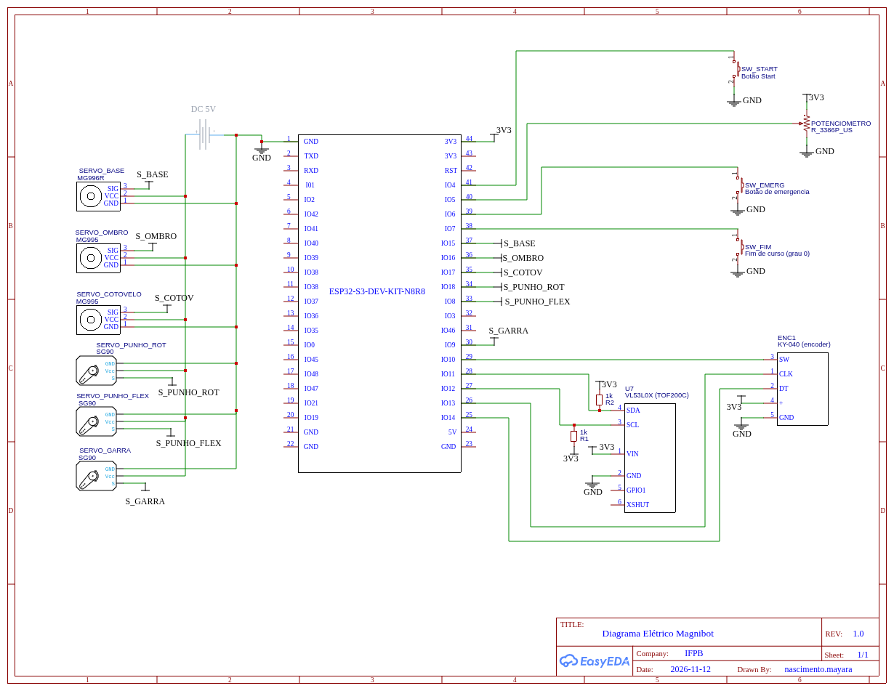

# Diagramas do MagniBot

## Sobre o projeto

O MagniBot é um braço robótico de 5/6 graus de liberdade controlado por um ESP32-S3 (kit ESP32-S3-DevKitC-1). O firmware é escrito em C, com ESP-IDF e FreeRTOS, em arquitetura modular. O projeto é o trabalho final de Sistemas Embarcados (2026.2).

O braço executa um ciclo de **varredura, captura e depósito de objetos**:

1. **Varredura:** a base gira e o sensor ToF VL53L0X, na garra, mede a posição e a distância dos objetos ao alcance.
2. **Confirmação:** o operador confirma o transporte ou pede uma nova busca.
3. **Transporte:** o braço vai até o objeto, fecha a garra, leva o objeto à posição de destino (45°), solta e volta ao repouso (0°).

O sistema tem quatro estados (IDLE, RUN_VARREDURA, VARREDURA_CONCLUIDA, RUN_DESLOCAMENTO), indicados pelo LED WS2812 onboard (GPIO48):

| Estado | Cor do LED |
|---|---|
| IDLE | Verde |
| RUN_VARREDURA | Azul |
| VARREDURA_CONCLUIDA | Amarelo |
| RUN_DESLOCAMENTO | Magenta |
| ERRO / EMERGÊNCIA | Vermelho |

O botão Start é interpretado pela duração do toque: um toque simples inicia a varredura, dois toques rápidos confirmam o transporte e um toque longo descarta o mapa e reinicia a busca. A parada de emergência é por interrupção, com latch: depois dela o sistema só volta a operar com reinicialização, nunca automaticamente.

---

## 1. Diagrama esquemático

### 1.1 Componentes

| Referência | Componente | Função |
|---|---|---|
| ESP32-S3-DEV-KIT-N8R8 | Microcontrolador | Controle, aquisição e telemetria |
| SERVO_BASE | MG996R | Giro da base |
| SERVO_OMBRO | MG995 | Articulação do ombro |
| SERVO_COTOVELO | MG995 | Articulação do cotovelo |
| SERVO_PUNHO_ROT | SG90 | Rotação do punho |
| SERVO_PUNHO_FLEX | SG90 | Flexão do punho |
| SERVO_GARRA | SG90 | Abertura e fechamento da garra |
| SW_START | Botão | Botão Start (toque simples, duplo e longo) |
| SW_EMERG | Botão | Botão de emergência externo (interrupção por borda de descida) |
| SW_FIM | Botão | Fim de curso (referência do grau 0) |
| POTENCIOMETRO | R_3386P_US | Entrada analógica |
| ENC1 | Encoder KY-040 | Encoder rotativo com botão |
| U7 | VL53L0X (TOF200C) | Sensor ToF de distância, por I2C |
| R1, R2 | Resistores de 1 kΩ | Pull-ups do barramento I2C |
| DC 5V | Fonte externa | Alimentação dos servos |

### 1.2 Mapa de pinos

| GPIO | Sinal | Destino |
|---|---|---|
| IO4 | Entrada | SW_START |
| IO5 | Entrada analógica | Cursor do potenciômetro |
| IO6 | Entrada (interrupção) | SW_EMERG |
| IO7 | Entrada | SW_FIM |
| IO15 | PWM | S_BASE (MG996R) |
| IO16 | PWM | S_OMBRO (MG995) |
| IO17 | PWM | S_COTOV (MG995) |
| IO18 | PWM | S_PUNHO_ROT (SG90) |
| IO8 | PWM | S_PUNHO_FLEX (SG90) |
| IO9 | PWM | S_GARRA (SG90) |
| IO10 | Entrada | ENC1 SW |
| IO13 | Entrada | ENC1 CLK |
| IO14 | Entrada | ENC1 DT |
| IO11 | I2C SDA | VL53L0X |
| IO12 | I2C SCL | VL53L0X |
| GPIO48 | Saída | LED WS2812 onboard |

### 1.3 Alimentação

- Os seis servos são alimentados pela fonte externa de 5 V, em um barramento separado do ESP32.
- O GND da fonte é comum ao GND do ESP32, para que o sinal PWM tenha referência.
- Os sensores e os botões usam 3V3 do kit. Os botões ligam o pino ao GND.

---

## 2. Diagrama de blocos

